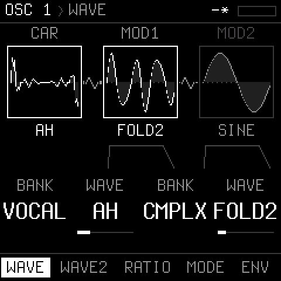

# Prysm

**A 4-voice wavetable FM synthesizer firmware for the M-VAVE FM-1.**

<p align="center"></p>

Two oscillators per voice, each a chain of three wavetable operators (mod 2 -> mod 1 -> carrier) that modulate
each other by FM, ring or mix; a resonant filter (12 / 24 dB low-pass or a comb) with drive and a high-pass; an LFO with six shapes and two destinations; a second, tempo-syncable LFO with many more; a mod
envelope that can loop and modulate the LFO's rate; stereo chorus, delay (with wow and pitch-shifting repeats) and
a plate reverb (with modulation and shimmer); 8 patch slots; graphical pages; USB audio and MIDI.

- **See it**: [the demo video](https://www.youtube.com/watch?v=mpHz8HwsCX0) (2½ minutes: the screen and the sound)
- **Install it**: [the web installer](https://nicholaspratt.github.io/Prysm/) (Chrome or Edge), or `tools/fm1_install.py` (below)
- **Try it in a browser**: [the editor](https://nicholaspratt.github.io/Prysm/editor/): Prysm itself, running in the page, with every
  parameter on screen; connected to an FM-1 (0.8 or later) the two stay in step
- **In your DAW**: [the CLAP plugin](plugin/README.md) (macOS, Windows, Linux): Prysm's engine as an instrument, every
  parameter automatable, the editor as its window, a connected FM-1 kept in step
- **Use it**: [the manual](docs/MANUAL.md) ([as a page](https://nicholaspratt.github.io/Prysm/manual.html))
- **Build it**: [SETUP-MACOS.md](SETUP-MACOS.md), and below

> Prysm is a community firmware, not made or supported by M-VAVE. Installing firmware is at your own risk. If an
> FM-1 does not start after an update, hold **OCT-** while switching it on: the rescue updater.

## The sound

| | |
| --- | --- |
| **Voices** | 4, polyphonic |
| **Oscillators** | 2 per voice; each a carrier modulated by mod 1, modulated by mod 2. Each operator: 6 banks x 8 morphing waves (BASIC, HARM, PULSE, VOCAL, DIGI, CMPLX), a ratio to the note (0.5 .. 16); each modulator: FM / RING / MIX, an amount, its own AR envelope |
| **Filter** | state-variable low-pass, 12 or 24 dB/oct (zero-delay feedback), or a Blofeld-style comb (COMB+ / COMB-: the cutoff its frequency, resonance its feedback, plus damping and spread); self-oscillation at the top of RES (a steady, keytracked sine at any cutoff); drive, keytrack, its own ADSR; a 12 dB/oct high-pass (no resonance) |
| **Amp** | ADSR |
| **LFO** | sine, triangle, saw up / down, square, S&H; 0.05 .. 40 Hz; delay; retrig or free-running; two destinations (pitch, wave positions, mod amounts, the modulators' pitch, cutoff, amp, mix) |
| **LFO 2** | one for all the voices; the same shapes; free (0.05 .. 40 Hz) or in time (4/1 .. 1/32, triplets); any LFO destination, or resonance, drive, high-pass, comb damping, filter envelope amount, levels, osc 2 detune, the mod envelope's amount, the effects' mixes, delay time and feedback, reverb size |
| **Mod envelope** | ADSR with LOOP (attack-decay until release); into the LFO's rate or depth, or any LFO destination |
| **Effects** | stereo chorus; delay up to 735 ms with ping-pong, tone, wow and per-repeat pitch shift; Dattorro plate reverb with pre-delay, damping, modulation and shimmer |
| **Velocity** | from MIDI, to level, cutoff and modulation (the FM-1's keys play at full velocity) |
| **Glide** | portamento, always or legato |
| **Arpeggiator** | UP, DOWN, UPDN, RAND, ORDER; 1/4 .. 1/32 with triplets; 1 .. 4 octaves; gate (to tied), swing, latch; 40 .. 240 BPM or the MIDI clock (START / STOP / CONTINUE); sample-accurate |
| **Sequencer** | 4 patterns of up to 64 steps, 303-style: notes, rests, accents, slides (legato glide), ties; a song of up to 16 entries, each a pattern played 1 .. 16 times; row copy / paste; step entry from the keys (REC); its own or the MIDI clock |
| **Oscilloscope** | on HOME: left and right, locked to the newest note, auto-zoom |
| **Patches** | 8 slots, saved in flash (power-cut safe), the last one back at power-on |
| **Editor** | [in the browser](https://nicholaspratt.github.io/Prysm/editor/): the firmware itself running in the page (screen, knobs, keys, sound), every parameter, patch files; in sync with a connected FM-1 both ways |
| **USB** | class-compliant stereo audio input ("Prysm FM-1", 44.1 / 48 kHz, works on macOS 14) and MIDI in / out, with channel select and clock |

Everything runs in fixed point on the FM-1's JieLi AC791N (no FPU); the header shows how much of the audio budget
the sound takes.

## The pages

ALGORITHM steps through the pages (or a button jumps to one), SELECT picks a row, KNOB1..4 edit its four values;
PRESETS is the filter's cutoff on every page.
Every page draws what it does: the oscillator chain with its live waves, the filter's response curve, the
envelopes, the LFO, the effects chain.

| Page | Button | Rows |
| --- | --- | --- |
| OSC 1, OSC 2 | EDIT | WAVE, WAVE2, RATIO, MODE, ENV, MIX |
| FILTER | ENV (twice) | FILTER, ENV, TYPE, COMB |
| AMP | ENV | ENV, VEL |
| LFO | LFO (twice: LFO 2) | LFO, DEST, M.ENV, M.DST; LFO 2: LFO, DEST |
| MIX | GLO | OSC, GLIDE |
| SETUP | GLO (twice) | MIDI: IN / OUT channels, CLOCK, pitch BEND range |
| ARP | ARP (again: on / off) | ARP, TIME |
| SEQ | SEQ (PLAY: run, REC: step entry) | STEP, PATTERN, EDIT, SONG, ENTRY |
| CHORUS / DELAY / REVERB | FX (1, 2, 3 times) | CHORUS; DELAY, D.MOD; REVERB, R.MOD |
| PATCH | SAVE | SAVE, LOAD, INIT over 8 slots |
| SCOPE | HOME | the output, live (KNOB1: cycles) |

## Installing from the command line

```sh
pip3 install mido python-rtmidi
python3 tools/fm1_install.py prysm-0.8.fwsc       # asks before it writes; restarts into Prysm
python3 tools/fm1_install.py --info               # what the connected FM-1 runs
```

From ETCH: restore the official firmware first (ETCH only accepts its own updates). Back to the official firmware
or another one: the [FM-1 Firmware Hub](https://thefirmwarehub.com).

## Installing the CLAP plugin

Prysm in your DAW, as an instrument ([what it does](plugin/README.md)). It needs a DAW that loads CLAP plugins (Reaper and
Bitwig Studio among them). To keep an FM-1 in step with it, the FM-1 needs Prysm 0.8 or later.

1. Download the zip for your system from the [latest release](https://github.com/NicholasPratt/Prysm/releases/latest):
   `Prysm-clap-macos.zip`, `Prysm-clap-windows.zip` or `Prysm-clap-linux.zip`.
2. Unzip it: you get `Prysm.clap`.
3. Put `Prysm.clap` in your CLAP folder, as below for your system.
4. In your DAW, rescan the plugins (Reaper: *Options*, *Preferences*, *Plug-ins*, *CLAP*, *Re-scan*), then add
   **Prysm** to a track as an instrument.

**macOS** (10.15 or later, Intel or Apple Silicon)

- In Finder, *Go*, *Go to Folder...*, type `~/Library/Audio/Plug-Ins/CLAP` (if there is no `CLAP` folder, make one in
  `Plug-Ins`) and move `Prysm.clap` into it.
- The plugin is not notarized by Apple, so macOS blocks it until you clear the download mark. In Terminal:

  ```sh
  xattr -dr com.apple.quarantine ~/Library/Audio/Plug-Ins/CLAP/Prysm.clap
  ```

**Windows** (10 or 11, 64-bit)

- Move `Prysm.clap` into `C:\Program Files\Common Files\CLAP` (make the `CLAP` folder if there is none; Windows asks
  for permission).
- Its window uses Microsoft's Edge WebView2, which Windows 11 has, as does Windows 10 with its updates. If the window
  stays empty, install the
  [WebView2 Runtime](https://developer.microsoft.com/microsoft-edge/webview2/).
- With an FM-1: Windows lets only one program at a time use a MIDI port. In the DAW's MIDI settings, switch the FM-1's
  input and output off, so that Prysm can reach it (Reaper: *Preferences*, *MIDI Devices*, the FM-1, *Disabled*).

**Linux** (x86-64)

- Install GTK 3 and WebKitGTK 4.1, on Debian or Ubuntu:

  ```sh
  sudo apt install libgtk-3-0 libwebkit2gtk-4.1-0
  ```

- Then put the plugin in your CLAP folder:

  ```sh
  mkdir -p ~/.clap && cp Prysm.clap ~/.clap/
  ```

**With an FM-1:** connect it by USB before you open the project, or any time after. The plugin finds it by itself, and
its window's status line says when it is connected. The project's sound then goes to the FM-1, and what you turn on the
FM-1 comes back as the plugin's parameters.

**One Prysm per process:** a second Prysm in the same project stays silent, and its window says so. To use more than
one, run each in a process of its own (Reaper: the FX window's menu, *Run as*, *Separate process*).

## Building

The toolchain is JieLi's (Linux; on a Mac it runs in Docker). [SETUP-MACOS.md](SETUP-MACOS.md) has the details;
`tools/setup_macos.sh` sets it all up.

```sh
tools/setup_macos.sh                 # once: colima + docker, the JieLi toolchain, the AC79 SDK, a Python venv
export PATH="$PWD/.venv/bin:$PATH"
./build.sh                           # build/prysm.fwsc (identity FM-1_980)
./build.sh --release 0.8             # build/prysm-0.8.fwsc (identity FM-1_988, "0.8" on the splash)
tools/make_site.py build/prysm-0.8.fwsc 0.8   # site/: the web installer and the manual (GitHub Pages)
APP_VER=0.8 emu/build.sh             # site/editor/: Prysm in a browser, and the editor (needs emscripten: emsdk)
```

### Tests (on the computer, no FM-1 needed)

```sh
tests/run_engine.sh     # renders test sounds and checks them by spectrum: oscillators, filter, LFO, mod envelope,
                        # effects; and the patch bank's format conversions
tests/run_ui.sh         # screenshots of every page and of a save / load session: build/ui/*.png
tests/run_host.sh       # the whole app on the computer: build/host/prysm.wav and screens
```

### Where things are

| | |
| --- | --- |
| `firmware/src/engine.c` | the voices: oscillators, modulators, filter, envelopes, LFO, mod envelope |
| `firmware/src/fx.c` | chorus, delay, reverb |
| `firmware/src/ui.c` | the pages and the PATCH screen |
| `firmware/src/patches.c` | the 8 slots and their format conversions |
| `firmware/src/prysm.c` | the app: notes, the splash animation, the main loop |
| `firmware/src/platform.c`, `usb.c`, `hal/`, `loader/` | the platform (Dinghy / Felucca / SLOOP), with Prysm's USB audio layout and store |
| `tools/gen_prysm_tables.py`, `tools/gen_prysm_font.py` | the wavetables and lookup tables; the UI's Terminus fonts (FONT_M, FONT_P) |
| `tools/gen_splash.py` | the old splash picture (assets/splash.jpg; no longer shown) |
| `web/`, `tools/make_site.py` | the web installer |
| `firmware/src/capture.c`, `tools/capture.py` | performance capture: record a take on the FM-1, film it on the computer (MP4) |
| `firmware/src/editor.c`, `emu/`, `web/editor/` | the editor: parameters over USB-MIDI (SysEx); the firmware compiled for a browser; the page |
| `plugin/` | the CLAP plugin: the firmware as a library, the editor as its window, the FM-1 over USB-MIDI |
| `tools/demo.py` | the demo video: its patches (sent to an FM-1), its scenes scripted and filmed |
| `docs/` | the [manual](docs/MANUAL.md), the [design](docs/PRYSM-DESIGN.md), the platform's [API](docs/API.md) and [rules](docs/RULES.md) |

## Credits and licence

Prysm by Nicholas Pratt. It is built on [Dinghy](https://github.com/zvenson/dinghy) (zvenson), which carries the
platform of [Felucca](https://github.com/hugelton/Felucca) by Leo Kuroshita (Hügelton Instruments), as
[SLOOP](https://github.com/isod89/sloop-fm1) (isod89) carries it: the boot, the updater, the USB stack, the
screen and the flash driver are theirs. The reverb is Jon Dattorro's plate ("Effect Design, Part 1", JAES 1997). The
web installer's update protocol is Felucca's `web/fm1ota.js` and `web/fm1pkg.js`.

GPL-3.0 only: see [LICENSE](LICENSE) and [LICENSING.md](LICENSING.md). If you give someone a firmware built from
it, give them its source too. The package holds three JieLi AC79 SDK files (Apache-2.0, `LICENSES/`).

M-VAVE and FM-1 are trademarks of their respective owners.
